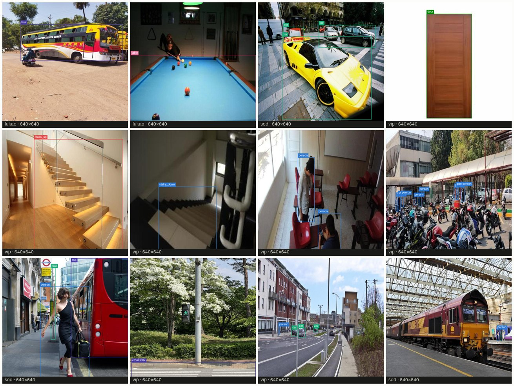
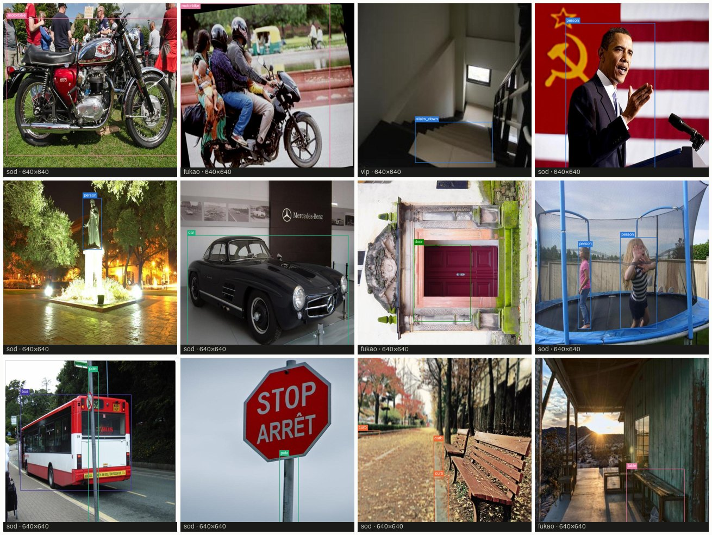
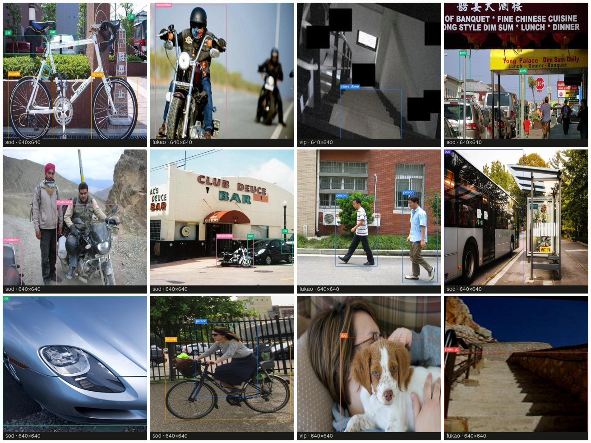
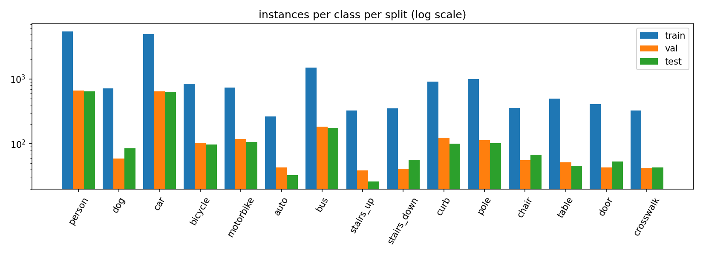
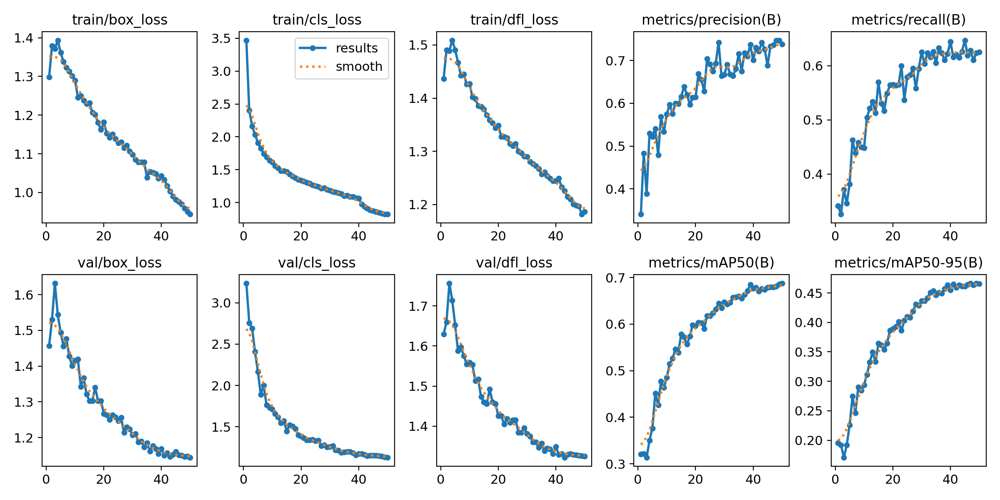
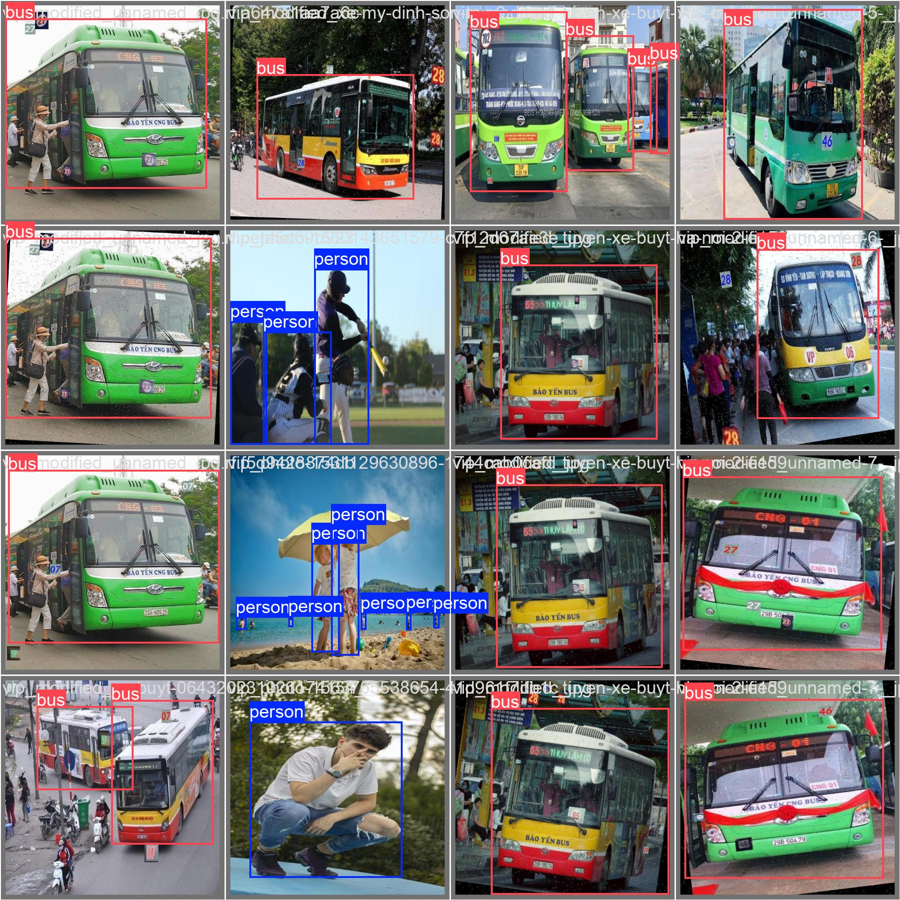
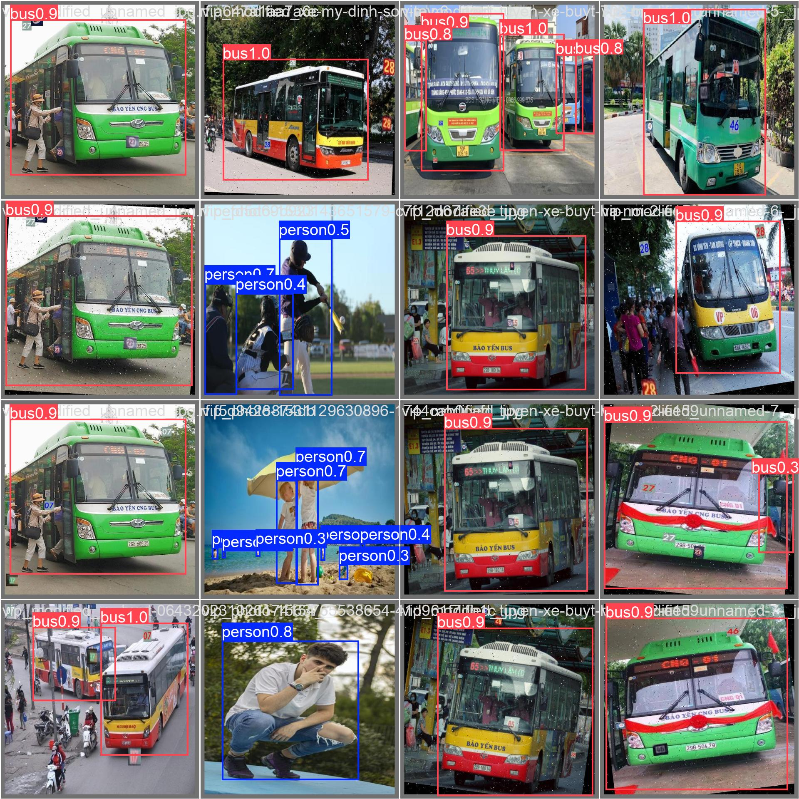
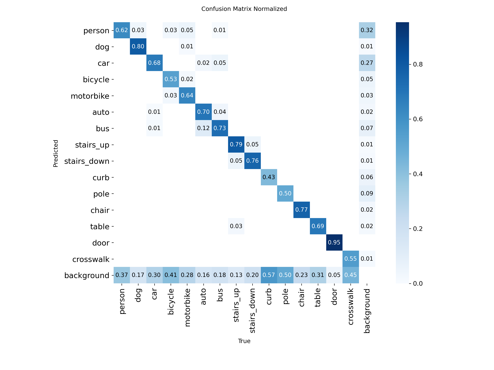
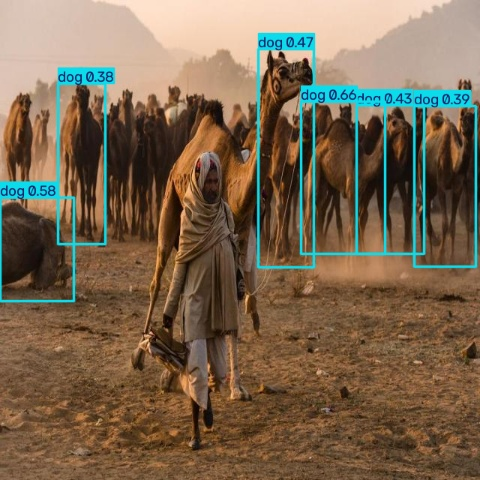

# Vision Assistant — detector dataset, training and test results

**Run** `n640_v1` · **Trained** 2026-09-13 · **Base model** YOLO11n (COCO-pretrained) · **Author** Divya Basavraj

> Open this file in VS Code and press **Cmd+Shift+V** (Mac) / **Ctrl+Shift+V** (Windows) for the rendered preview, or click the "Open Preview to the Side" icon top-right.

| COCO YOLO11n, before fine-tuning | Fine-tuned on our dataset |
|:--:|:--:|
| **0.264** mAP50 | **0.667** mAP50 (2.5×) · 0.462 mAP50-95 |

---

## 1. Dataset

Three public, CC BY 4.0 datasets from Roboflow Universe were merged into one dataset with 15 navigation-relevant classes. None alone covered everything a walking aid needs (stairs, curbs, poles, auto-rickshaws), and their class names disagreed, so each was translated to a shared vocabulary before training.

| | |
|---|---|
| Images after merge | **9,035** |
| Labelled boxes | **23,314** |
| Classes | **15** |
| Split | **80 / 10 / 10** → 7,228 train · 903 val · 904 test |

| Source dataset | Raw images | Source classes | What we took from it |
|---|--:|--:|---|
| Visually Impaired Persons (`vip`) | 9,919 | 43 | Indoor + street: stairs up/down, door, curb, crosswalk, chair, table |
| SOD-ENECT (`sod`) | 10,000 | 22 | Street obstacles: pole, curb, vehicles, person, dog |
| Blind-Navigation-Fukao (`fukao`) | 5,227 | 18 | Indian roads: auto-rickshaw, motorbike, stairs, doors, chairs |
| **Merged** | **9,035** | **15** | |

**How the merge works** (`training/scripts/merge_datasets.py`, mappings in `training/mappings/*.json`):

- **Class remapping** — each source's names are translated to ours: `Upstair → stairs_up`, `motorcycle → motorbike`, `auto-rikshaw → auto`, `occupied-chair / unoccupied-chair → chair`. Boxes for classes we don't need (Cup, Toothbrush, Vase …) are dropped.
- **Image filtering** — images left with no target-class boxes are removed; byte-identical duplicates are removed; for Fukao (exported with rotations/flips already applied) only one copy per original photo is kept so an augmented twin of a training image can never leak into val or test.
- **Re-split** — everything is pooled and split 80/10/10 with a fixed seed. The test split is never touched during training or tuning.

### What the images look like

Twelve random images per split with the **ground-truth boxes drawn from the label files** (not model output). Each tile's footer names the source dataset and original resolution. Regenerate a different draw with `python training/scripts/make_sample_sheets.py --seed N`.

**Training split** (7,228 images) — what the network learns from:

**Validation split** (903) — scored after every epoch to pick the best checkpoint:

**Test split** (904) — never seen during training or tuning; every number in section 3 comes from these:

Raw files: `training/data/merged/images/{train,val,test}/` with one label per image in `training/data/merged/labels/<split>/<name>.txt` (`class_id cx cy w h`, normalised 0–1).

### Instances per class

The dataset is imbalanced: person (5,463 train boxes) and car (4,992) dominate; auto (264), crosswalk (325) and stairs_up (326) are the rarest. Val and test follow the same proportions because they come from the same pool.

| Class | Train | Val | Test | | Class | Train | Val | Test |
|---|--:|--:|--:|---|---|--:|--:|--:|
| person | 5,463 | 661 | 644 | | stairs_down | 351 | 41 | 57 |
| car | 4,992 | 650 | 635 | | chair | 358 | 56 | 68 |
| bus | 1,510 | 184 | 175 | | door | 408 | 43 | 53 |
| pole | 1,006 | 114 | 102 | | table | 497 | 52 | 46 |
| curb | 908 | 124 | 100 | | stairs_up | 326 | 39 | 26 |
| bicycle | 843 | 103 | 98 | | crosswalk | 325 | 42 | 43 |
| motorbike | 741 | 118 | 106 | | auto | 264 | 43 | 33 |
| dog | 722 | 59 | 85 | | | | | |

---

## 2. Training

YOLO11n is a ~100-layer convolutional detector with 2.6 M weights — the smallest of the YOLO11 family, chosen so it runs at ~10 fps in a phone browser. Rather than training from scratch, the COCO-pretrained weights were **fine-tuned**: the network already knew edges, textures and common objects, and learned our 15 classes on top.

| Setting | Value |
|---|---|
| Starting weights | `yolo11n.pt` (COCO, 80 classes) |
| Epochs | 50 (ran to completion, no early stop) |
| Image size | 640 × 640 |
| Batch size | 32 |
| Optimizer / LR | auto, lr0 = 0.01, linear decay to 0.01 × lr0 |
| Augmentation | Ultralytics defaults (mosaic, HSV, flip, scale) |
| Hardware | Google Colab, NVIDIA T4 · 1.7 h |
| Seed | 0 |
| Export | ONNX opset 17, 10.6 MB → runs in-browser via onnxruntime-web |

Per-epoch curves from `n640_v1/results.csv`. Top row: training losses and validation precision / recall. Bottom row: validation losses and mAP. All three validation losses keep falling through epoch 50 and track the training losses, so the model is **not overfitting**; validation mAP50 rises from 0.32 to 0.688 and is still creeping up at the end (0.681 → 0.688 over the last three epochs), so it is if anything slightly under-trained.

| Epoch | train box loss | train cls loss | val box loss | val cls loss | Precision | Recall | val mAP50 | val mAP50-95 |
|--:|--:|--:|--:|--:|--:|--:|--:|--:|
| 1 | 1.298 | 3.471 | 1.457 | 3.235 | 0.341 | 0.341 | 0.321 | 0.195 |
| 10 | 1.290 | 1.613 | 1.416 | 1.712 | 0.575 | 0.448 | 0.486 | 0.294 |
| 25 | 1.128 | 1.256 | 1.246 | 1.329 | 0.691 | 0.579 | 0.617 | 0.410 |
| 50 | 0.944 | 0.822 | 1.145 | 1.130 | 0.738 | 0.625 | 0.688 | 0.466 |

---

## 3. Test results

Evaluated once on the **904-image test split**, held out from both training and model selection. The baseline is the same YOLO11n with its original COCO weights, scored on the same images: it can only detect the 8 of our classes that exist in COCO and scores 0 by definition on the other 7.

| | |
|---|---|
| mAP50, all 15 classes | **0.667** |
| mAP50-95, all 15 classes | **0.462** |
| Gain over COCO baseline (0.264) | **+0.403** |
| Classes above 0.45 mAP50 | **15 / 15** |

| Class | Test boxes | Baseline mAP50 | Fine-tuned mAP50 | Fine-tuned mAP50-95 | Δ mAP50 |
|---|--:|--:|--:|--:|--:|
| door | 53 | not in COCO | **0.950** | 0.840 | new |
| stairs_up | 26 | not in COCO | **0.924** | 0.706 | new |
| dog | 85 | 0.846 | **0.860** | 0.711 | +0.014 |
| bus | 175 | 0.729 | **0.830** | 0.630 | +0.101 |
| stairs_down | 57 | not in COCO | **0.765** | 0.344 | new |
| car | 635 | 0.485 | **0.700** | 0.484 | +0.215 |
| chair | 68 | 0.113 | **0.677** | 0.446 | +0.564 |
| table | 46 | 0.406 | **0.638** | 0.358 | +0.232 |
| motorbike | 106 | 0.451 | **0.597** | 0.364 | +0.146 |
| person | 644 | 0.455 | **0.561** | 0.357 | +0.106 |
| auto | 33 | not in COCO | **0.544** | 0.361 | new |
| crosswalk | 43 | not in COCO | **0.520** | 0.394 | new |
| curb | 100 | not in COCO | **0.502** | 0.341 | new |
| pole | 102 | not in COCO | **0.487** | 0.280 | new |
| bicycle | 98 | 0.481 | **0.453** | 0.316 | −0.028 |
| **All 15** | **2,271** | **0.264** | **0.667** | **0.462** | **+0.403** |

**Reading the numbers**

- **Every one of the 7 new classes is now detected.** Door (0.95) and stairs_up (0.92) are among the best classes overall — the ones that matter most for a walking aid.
- **Fine-tuning helped classes COCO already knew.** Chair +0.56, table +0.23, car +0.21, person +0.11: the source datasets look like the deployment environment (phone camera, street level), unlike COCO.
- **Weakest four:** bicycle 0.45 (only 843 train boxes, often small and partly hidden), pole 0.49, curb 0.50, crosswalk 0.52 — thin or low-contrast objects; the next data collection round targets them.
- **Bicycle dropped slightly** (0.48 → 0.45), the one regression. It is the smallest shared class in our data, so 50 epochs of our images slightly diluted what COCO knew.

**Ground truth vs model output** on a validation batch:

| Ground truth (human labels) | Model output (predicted boxes + confidence) |
|:--:|:--:|
|  |  |

**Confusion matrix** (rows = true class, columns = predicted, normalised):

The diagonal is strong for door, stairs_up, bus and dog. Most errors are on the *background* row and column — objects missed entirely, or boxes placed on nothing — rather than one class being confused with another.

**Known limitation:**

A camel herd is reported as six "dog" boxes and the person in front is missed. Camel is not one of the 15 classes, so the detector picks the nearest thing it knows. Out-of-vocabulary objects are an inherent limit of a closed-set detector; the app's cloud vision-language model ("what's this?") exists for exactly these cases.

> **What mAP50 means.** For each class, precision and recall are computed at every confidence level and the area under that curve is the average precision (AP). A predicted box counts as correct if it overlaps the true box by at least 50 % (IoU ≥ 0.5). mAP50 is the mean AP over the 15 classes. mAP50-95 averages the same over IoU thresholds from 0.5 to 0.95, so it also rewards tight boxes.

---

**Files:** `n640_v1/` (results.csv, n640_v1_test.json, confusion matrices, best.pt) · `baseline_test.md` · `../data/merged/counts.json` · `../train.ipynb`.
Re-evaluate with `yolo val model=training/results/n640_v1/best.pt data=training/data/merged/data.yaml split=test`.
